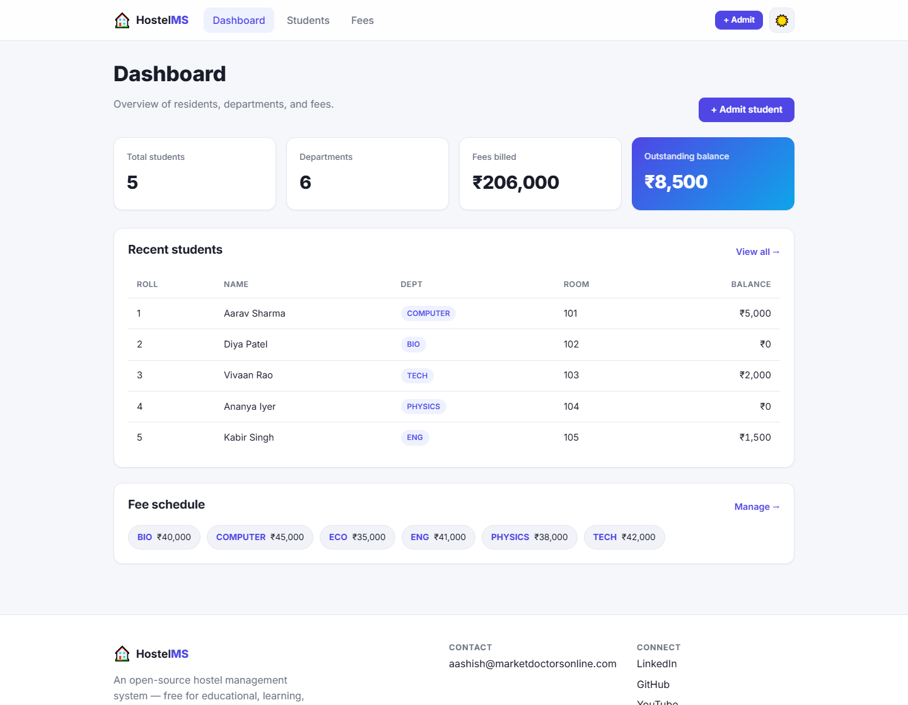
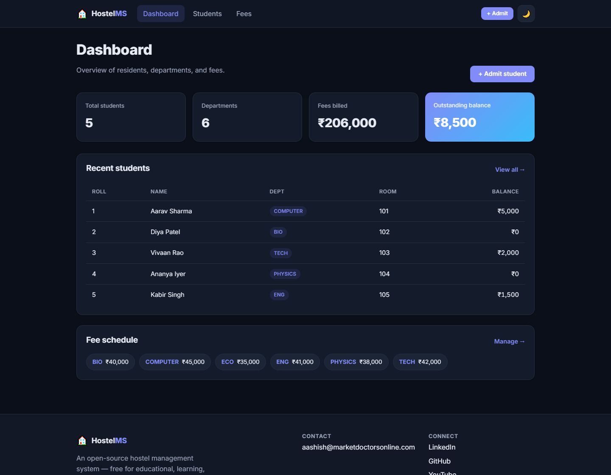
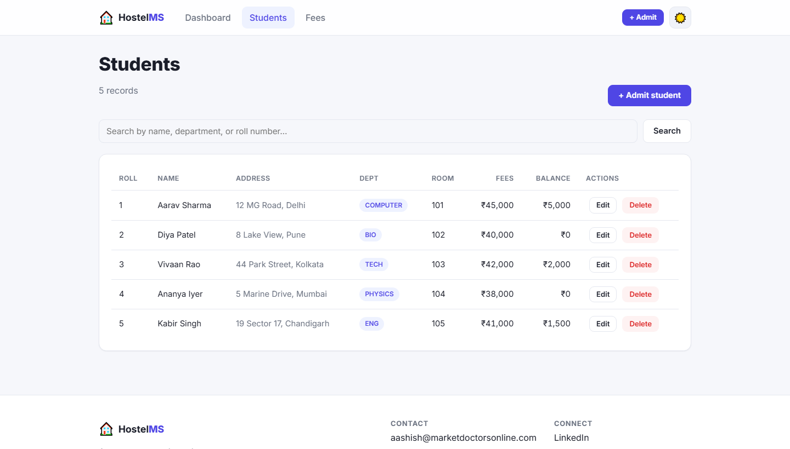
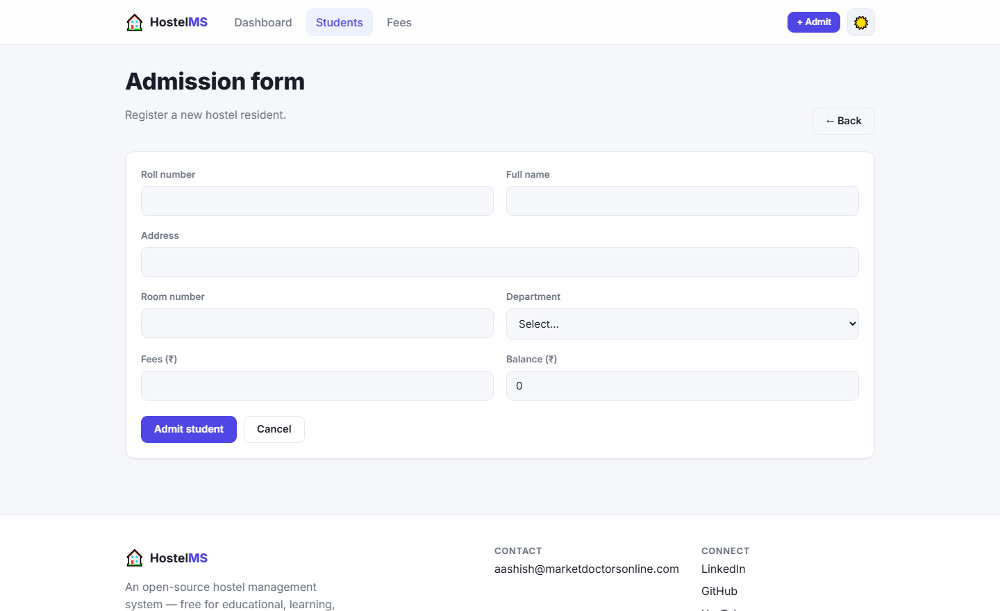
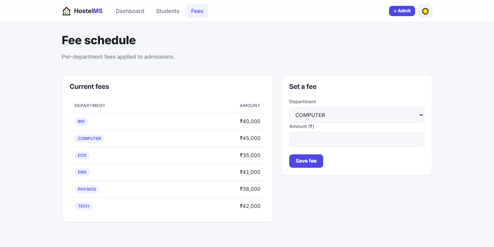
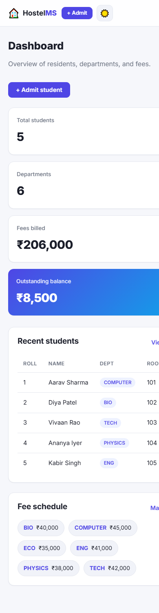

<div align="center">

# 🏠 Hostel Management System

**A modern, open-source hostel management system — a console app *and* a polished web dashboard.**

Manage student admissions, room allocation, and department fees from either a hardened
command-line interface or a responsive, accessible web dashboard with dark mode.

[](https://github.com/aashishbharti04/Hostel-Management-System/actions/workflows/ci.yml)
[](LICENSE)
[](https://www.python.org/)
[](https://github.com/astral-sh/ruff)

</div>

---

## 📋 Table of Contents

- [Overview](#-overview)
- [Features](#-features)
- [Screenshots](#-screenshots)
- [Tech Stack](#-tech-stack)
- [Installation](#-installation)
- [Usage](#-usage)
- [Configuration](#-configuration)
- [Deployment](#-deployment)
- [Documentation](#-documentation)
- [Contributing](#-contributing)
- [FAQ](#-faq)
- [License](#-license)
- [Contact](#-contact)

---

## 🔭 Overview

This project began as a single-file CBSE Class-12 console script and has been refactored
into a **production-ready, layered application** while preserving every original feature.
It now ships with:

- A **hardened command-line interface** (the original menu, made safe and friendly).
- A **modern web dashboard** built with Flask — responsive, accessible, with light/dark themes.
- A clean **service / repository / model** architecture shared by both front-ends.
- A **zero-config SQLite** default so anyone can run it instantly, with **MySQL** fully supported.
- A test suite, linting, CI, and complete documentation.

> **Why two front-ends?** The service layer contains all business rules, so the CLI and the
> web dashboard behave identically — no duplicated logic.

---

## ✨ Features

| Feature | CLI | Web Dashboard |
| --- | :---: | :---: |
| Student admission (create) | ✅ | ✅ |
| View / edit student records | ✅ | ✅ |
| Delete records | ✅ (admin) | ✅ |
| Department fee lookup | ✅ | ✅ |
| Manage fee schedule | — | ✅ |
| Live search & filtering | — | ✅ |
| Dashboard statistics | — | ✅ |
| JSON REST API | — | ✅ |
| Dark / light mode | — | ✅ |

**Cross-cutting:**

- 🔒 **Parameterised queries** everywhere — the original SQL-injection holes are gone.
- 🧱 **Input validation** in a single source of truth shared by both interfaces.
- 🎨 **Premium UI** — typography, spacing, color hierarchy, smooth animations, skeleton/empty/error states.
- ♿ **Accessible** — semantic HTML, ARIA, skip links, focus styles, `prefers-reduced-motion`.
- 📱 **Responsive** — mobile, tablet, and desktop layouts.
- 🔍 **SEO-ready** — meta tags, Open Graph, semantic structure.
- 🗄️ **Backend-agnostic** — SQLite (default) or MySQL via environment variables.

---

## 📸 Screenshots

### Dashboard — Light & Dark

| Light | Dark |
| --- | --- |
|  |  |

### Students & Admission

| Students list | Admission form |
| --- | --- |
|  |  |

### Fees & Mobile

| Fee schedule | Mobile view |
| --- | --- |
|  |  |

---

## 🛠 Tech Stack

- **Language:** Python 3.10+
- **Web framework:** Flask 3 (server-rendered Jinja2 + progressive-enhancement JS)
- **Database:** SQLite (default) / MySQL (optional)
- **Styling:** Hand-written CSS design system with custom properties (no build step)
- **Tooling:** pytest, ruff, GitHub Actions

---

## 🚀 Installation

### Prerequisites

- Python **3.10 or newer**
- (Optional) MySQL server, only if you choose the MySQL backend

### Steps

```bash
# 1. Clone the repository
git clone https://github.com/aashishbharti04/Hostel-Management-System.git
cd Hostel-Management-System

# 2. Create and activate a virtual environment
python -m venv .venv
# Windows
.venv\Scripts\activate
# macOS / Linux
source .venv/bin/activate

# 3. Install dependencies
pip install -r requirements.txt

# 4. Copy the example environment file
cp .env.example .env        # Windows: copy .env.example .env

# 5. (Optional) Seed sample data
python -m hostel_management.seed
```

---

## 📖 Usage

### Web Dashboard

```bash
python run_web.py
# Open http://127.0.0.1:5000
```

### Command-Line Interface

```bash
python run_cli.py
# or, after `pip install -e .`
hms-cli
```

The CLI preserves the original menu:

```
1. Admission Form        2. Fee Checking
3. Modify / View Data    4. Authorities Only
5. Quit
```

### JSON API

| Method | Endpoint | Description |
| --- | --- | --- |
| GET | `/api/stats` | Dashboard statistics |
| GET | `/api/students` | List all students |
| GET | `/api/students/<roll_no>` | Single student |
| GET | `/api/fees` | Fee schedule |
| GET | `/healthz` | Health check |

See [docs/API.md](docs/API.md) for full details.

---

## ⚙️ Configuration

All configuration is via environment variables (loaded from `.env` locally). See
[`.env.example`](.env.example) for the complete list.

| Variable | Default | Description |
| --- | --- | --- |
| `HMS_DB_BACKEND` | `sqlite` | `sqlite` or `mysql` |
| `HMS_SQLITE_PATH` | `hostel.db` | SQLite file path |
| `MYSQL_HOST` / `MYSQL_PORT` | `localhost` / `3306` | MySQL connection |
| `MYSQL_USER` / `MYSQL_PASSWORD` | `root` / *(empty)* | MySQL credentials |
| `MYSQL_DATABASE` | `hostel_management` | MySQL database name |
| `HMS_SECRET_KEY` | `dev-secret-change-me` | Flask session secret (**set in production**) |
| `HMS_ADMIN_PASSWORD` | `admin` | Password for CLI admin actions |
| `HMS_DEBUG` | `false` | Flask debug mode (never enable in production) |

### Using MySQL

```bash
# .env
HMS_DB_BACKEND=mysql
MYSQL_USER=root
MYSQL_PASSWORD=yourpassword
MYSQL_DATABASE=hostel_management
```

Create the database once (`CREATE DATABASE hostel_management;`); tables are created
automatically on first run.

---

## 🌐 Deployment

For production, run behind a real WSGI server:

```bash
# Linux / macOS
gunicorn wsgi:app --bind 0.0.0.0:8000

# Windows
pip install waitress
waitress-serve --port 8000 wsgi:app
```

Set a strong `HMS_SECRET_KEY`, keep `HMS_DEBUG=false`, and put it behind a reverse proxy
(nginx/Caddy) with HTTPS. Full guide: [docs/DEPLOYMENT.md](docs/DEPLOYMENT.md).

---

## 📚 Documentation

- [Architecture](docs/ARCHITECTURE.md) — layers, data flow, design decisions
- [Folder Structure](docs/FOLDER_STRUCTURE.md) — what lives where
- [API Reference](docs/API.md) — JSON endpoints
- [Deployment Guide](docs/DEPLOYMENT.md) — production setup
- [Development Setup](docs/DEVELOPMENT.md) — local dev, tests, linting

---

## 🤝 Contributing

Contributions are welcome! Please read [CONTRIBUTING.md](CONTRIBUTING.md) and our
[Code of Conduct](CODE_OF_CONDUCT.md) first. In short:

1. Fork & branch (`git checkout -b feat/my-feature`)
2. `pip install -r requirements-dev.txt`
3. Make your change, add tests, run `ruff check .` and `pytest`
4. Open a Pull Request using the template

---

## ❓ FAQ

<details>
<summary><strong>Do I need MySQL to run this?</strong></summary>

No. The default backend is SQLite, which requires zero setup. MySQL is optional.
</details>

<details>
<summary><strong>Is the original console program still here?</strong></summary>

Its functionality is fully preserved in the modern CLI (`run_cli.py`). The logic was
refactored into a safe, tested package — the single-file script was replaced, not lost.
</details>

<details>
<summary><strong>How is SQL injection prevented?</strong></summary>

Every query is parameterised in `hostel_management/database.py`. User input is never
concatenated into SQL. There's even a test (`test_sql_injection_is_neutralised`) proving it.
</details>

<details>
<summary><strong>Can I use the API from another app?</strong></summary>

Yes — the read endpoints under `/api` return JSON. See [docs/API.md](docs/API.md).
</details>

---

## 📄 License

Distributed under the **MIT License**. See [LICENSE](LICENSE) for details.

---

## 📬 Contact

**Aashish Bharti**

- 📧 Email: [aashish@marketdoctorsonline.com](mailto:aashish@marketdoctorsonline.com)
- 💼 LinkedIn: [aashana1012](https://in.linkedin.com/in/aashana1012)
- 🐙 GitHub: [@aashishbharti04](https://github.com/aashishbharti04)
- ▶️ YouTube: [@CodeWithAsur](https://www.youtube.com/@CodeWithAsur)
- 📸 Instagram: [@asurwave1012](https://www.instagram.com/asurwave1012?igsh=ZDBlY2NtczJ5cmMw)

---

<div align="center">

© 2026 Hostel Management System. All rights reserved.

*This project is open source and available for educational, learning, and community contributions.*

</div>
